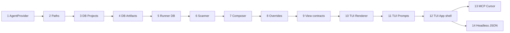

# Pulse — Roadmap de evolução arquitetural

Documento consolidado das decisões de arquitetura e plano de implementação em fases.
Cada fase corresponde a **um PR** com responsabilidade única e diff pequeno (~100–400 linhas).

**Especificações detalhadas:** [specs/README.md](specs/README.md) — produto e técnico por fase em `specs/phases/`.

---

## Contexto

O **pulse-cursor-task** é um orquestrador Python que executa workflows interativos (PRD, TechSpec, ADRs) via agentes de IA. Hoje opera como CLI terminal-first, acoplado ao Cursor, com paths hardcoded e artefatos salvos em disco.

**Escopo deste roadmap:** backend Python com **interações de view exclusivamente via terminal (TUI)** e **execução exclusivamente via Cursor** (SDK, ACP, stream-cli).  
**Fora de escopo:** Flutter Desktop, sidecar HTTP/WebSocket, empacotamento gráfico e providers alternativos (Ollama, cloud).

### Estado atual

```
Terminal (stdout + input())
        ↕
cursor-task CLI / biblioteca Python
        ├── StreamRenderer (tags [STATUS], [OUTPUT], [QUESTION]…)
        └── QuestionHandler (input de linha única)
        ↕
Executores Cursor (SDK, ACP, stream-cli)
        ↕
Skills em references/ + artefatos em .workflow/tasks/
```

### Estado alvo

```
Terminal TUI (Textual) — pulse CLI interativo
        ↕
Orquestrador Python (cursor-task / pulse)
        ├── Workflow Engine (skills, fases, aprovação)
        ├── TerminalView (StreamRenderer + QuestionHandler injetáveis)
        ├── ProjectContextScanner (re-sync a cada workflow)
        ├── ArtifactRepository (SQLite)
        ├── Project Registry
        └── AgentProvider (abstração)
                └── Cursor apenas (SDK, ACP, stream-cli)
                ↕
        project_path dinâmico (filesystem do usuário)
```

---

## Decisões de arquitetura

| # | Decisão | Detalhe |
|---|---------|---------|
| 1 | **Terminal-first** | Toda interação de view (streaming, perguntas, menus, projetos) via TUI no terminal; skill `terminal-ui` como guia de UX |
| 2 | **Cursor-only (runtime)** | Único provider operacional é Cursor; contrato `AgentProvider` prepara extensão futura sem expor outros vendors agora |
| 3 | **Paths dinâmicos** | `project_path` por projeto, registrado no SQLite; sem defaults hardcoded |
| 4 | **Artefatos no DB** | SQLite como fonte da verdade para PRD, TechSpec e ADRs; export `.md` opcional |
| 5 | **Rules/tools sem cache** | Re-scan do filesystem no início de **cada workflow**; DB guarda só overrides (toggles) |
| 6 | **Três camadas de contexto** | Pulse (skills globais) → Projeto (rules/tools) → Tarefa (artefatos do DB) |
| 7 | **View injetável** | `StreamRenderer` e `QuestionHandler` são contratos; TUI, modo plain e `--json` compartilham o runner |
| 8 | **PRs pequenos** | Uma responsabilidade por fase; ideal < 250 linhas de diff |

### Camada de view terminal

Implementação alvo: **[Textual](https://textual.textualize.io/)** (Python), seguindo os princípios da skill `backend/.cursor/skills/terminal-ui/`:

| Princípio (skill) | Aplicação no Pulse |
|-------------------|-------------------|
| `render-overwrite-dont-clear`, `render-partial-updates` | Painéis de streaming atualizados in-place, sem limpar tela |
| `render-synchronized-output` | Synchronized Output Protocol para animações de status |
| `input-escape-routes` | Esc/Ctrl+C cancela prompt ou workflow com saída limpa |
| `input-immediate-feedback` | Destaque visual imediato em seleção de opções A/B/C/D |
| `prompt-validation`, `prompt-cancellation` | Respostas vazias rejeitadas; cancelamento gracioso |
| `prompt-spinner-tasks`, `ux-progress-indicators` | Spinner durante execução do agente (> 1 s) |
| `tuicomp-static-for-logs` | Log de output/thinking em região estática (scrollback preservado) |
| `ux-color-semantics` | Verde sucesso, vermelho erro, amarelo thinking, neutro output |
| `robust-tty-detection` | Sem TTY → fallback plain ou `--json` (CI/scripts) |
| `robust-terminal-restore` | Restaurar estado do terminal ao sair (sucesso ou erro) |
| `tuicfg-json-output`, `tuicfg-flags-over-args` | `--json` para automação; flags explícitas na CLI |

Modos de operação:

| Modo | Quando | Renderer / Handler |
|------|--------|-------------------|
| **TUI** | TTY interativo (padrão) | `TextualStreamRenderer` + `TextualQuestionHandler` |
| **Plain** | `PULSE_PLAIN=1` ou `--plain` | `StreamRenderer` + `QuestionHandler` (atual) |
| **JSON** | `--json` ou pipe/CI | `JsonStreamRenderer` + respostas via stdin JSON |

### Precedência de contexto

```
Tarefa (artefatos DB)  >  Projeto (rules/tools scan)  >  Pulse (skills, hard-gates)
```

Hard-gates do orquestrador (ex.: não salvar PRD sem aprovação) **nunca** são sobrescritos por rules do projeto.

### O que fica no DB vs filesystem

| Dado | Onde |
|------|------|
| Rules, skills locais, MCP, tools | Filesystem — re-scan a cada workflow |
| PRD, TechSpec, ADRs | SQLite — versionados |
| Projetos (`local_path`, nome) | SQLite |
| Overrides (rule/MCP desabilitados) | SQLite — só toggles, sem conteúdo |

### Descoberta de contexto do projeto (scanner)

Arquivos lidos a cada workflow:

**Rules**

| Arquivo / pasta | Prioridade |
|-----------------|------------|
| `.pulse/rules/**` | Alta (convenção Pulse) |
| `.cursor/rules/**/*.mdc` | Alta |
| `.cursor/rules/**/*.md` | Alta |
| `AGENTS.md` | Alta |
| `.cursorrules` | Média |
| `CLAUDE.md` | Média |
| `.github/copilot-instructions.md` | Baixa |

**Skills locais**

| Local |
|-------|
| `.pulse/skills/**/SKILL.md` |
| `.cursor/skills/**/SKILL.md` |

**Tools / MCP**

| Arquivo |
|---------|
| `.pulse/mcp.json` |
| `.cursor/mcp.json` |
| `mcp.json` (raiz) |
| `.pulse/tools.yaml` |

---

## Diagrama de dependências entre fases



Fases 13 e 14 paralelizáveis após a 12.

---

## Fases de implementação

### Fase 1 — Contrato `AgentProvider`

**PR:** `refactor: extrair contrato AgentProvider dos executores Cursor`

**Responsabilidade:** renomear a abstração sem mudar comportamento.

**Tasks:**

- [ ] Renomear `CursorExecutor` → `AgentProvider` em `executor/base.py`
- [ ] Atualizar `SdkExecutor`, `AcpCliExecutor`, `StreamCliExecutor`
- [ ] Atualizar `factory.py` e imports
- [ ] Garantir que testes existentes passam sem alteração de comportamento

**Entrega:** ~150 linhas. Zero feature nova.

**Fora de escopo:** novos providers (Ollama, OpenAI), TUI, DB, flags `--provider`.

---

### Fase 2 — Paths dinâmicos obrigatórios

**PR:** `refactor: remover paths hardcoded e exigir project_path`

**Responsabilidade:** eliminar fallback silencioso de `DEFAULT_PROJECT_PATH` e `DEFAULT_ARTIFACTS_PATH`.

**Tasks:**

- [ ] Remover ou tornar `None` as constantes hardcoded em `types.py`
- [ ] Validar `project_path` obrigatório em `RunCursorTaskOptions` e CLI
- [ ] Mensagem de erro clara quando path ausente ou inválido
- [ ] Atualizar testes para paths explícitos via `tempfile`
- [ ] Atualizar README

**Entrega:** ~80–120 linhas.

**Depende de:** Fase 1.

---

### Fase 3 — SQLite: entidade Project

**PR:** `feat: persistência de projetos em SQLite`

**Responsabilidade:** CRUD de projetos — sem artefatos ou TUI.

**Tasks:**

- [ ] Adicionar `sqlalchemy`, `alembic` ao `pyproject.toml`
- [ ] Criar `persistence/` com session e base
- [ ] Model + migration: `projects` (`id`, `name`, `local_path`, `created_at`, `last_opened_at`)
- [ ] `ProjectRepository`: `create`, `get`, `list`, `delete`
- [ ] Testes unitários com SQLite in-memory

**Entrega:** ~200 linhas.

**Depende de:** Fase 2.

---

### Fase 4 — SQLite: workflows e artefatos

**PR:** `feat: schema de workflows e artefatos versionados`

**Responsabilidade:** modelagem e repositório — sem integrar ao runner.

**Tasks:**

- [ ] Migration: `workflows` (`id`, `project_id`, `slug`, `kind`, `status`, `provider`, `model`)
- [ ] Migration: `artifacts` (`id`, `workflow_id`, `kind`, `content`, `version`, `status`, timestamps)
- [ ] `ArtifactRepository`: `save`, `get_latest`, `list_by_workflow`, `get_version`
- [ ] Testes de versionamento (v1 → v2 → get_latest)

**Entrega:** ~250 linhas.

**Depende de:** Fase 3.

---

### Fase 5 — Runner persiste artefatos no DB

**PR:** `feat: gravar PRD/TechSpec no banco após aprovação`

**Responsabilidade:** substituir disco como fonte da verdade na conclusão do workflow.

**Tasks:**

- [ ] Criar workflow record no início de `_run_task`
- [ ] Após aprovação, `ArtifactRepository.save()` em vez de `ArtifactWriter.write()`
- [ ] TechSpec: ler PRD de entrada via DB (fallback temporário para arquivo)
- [ ] `RunCursorTaskResult` retorna `artifact_id`
- [ ] Flag `--export-md` para dump opcional em disco
- [ ] Atualizar testes de `completion` e runner

**Entrega:** ~200 linhas.

**Depende de:** Fase 4.

---

### Fase 6 — Scanner de contexto do projeto

**PR:** `feat: scanner stateless de rules, skills e MCP`

**Responsabilidade:** descobrir contexto de IA no filesystem — sem composição de prompt.

**Tasks:**

- [ ] Criar `project_context/scanner.py`
- [ ] Descobrir rules, skills, MCP e tools declarativas (ver tabela acima)
- [ ] Dataclasses: `ProjectContext`, `Rule`, `McpServer`, `ToolDef`
- [ ] Fixture `tests/fixtures/sample-project/` + testes

**Entrega:** ~300 linhas. Função pura: `scan(local_path) -> ProjectContext`.

**Depende de:** Fase 2.

---

### Fase 7 — Compositor de contexto no workflow

**PR:** `feat: re-sync de contexto e composição de prompt por workflow`

**Responsabilidade:** integrar scanner ao início de cada execução.

**Tasks:**

- [ ] Criar `project_context/composer.py` — merge: skill Pulse + rules projeto + artefatos DB
- [ ] Chamar `scanner.scan(project_path)` no início de `_run_task`
- [ ] Substituir `augment_workflow_paths` por composição estruturada
- [ ] Truncamento por budget de tokens (ordem de prioridade documentada)
- [ ] Testes: alterar rule no fixture → prompt muda

**Entrega:** ~200 linhas.

**Depende de:** Fases 5 e 6.

---

### Fase 8 — Overrides de projeto

**PR:** `feat: overrides de rules e MCP por projeto`

**Responsabilidade:** preferências do usuário no DB — conteúdo continua vindo do scan.

**Tasks:**

- [ ] Migration: `project_settings` (`disabled_rules`, `disabled_mcp`, `model_override`, `executor_override`)
- [ ] `SettingsRepository` + merge pós-scan
- [ ] Testes: rule desabilitada não aparece no prompt

**Entrega:** ~150 linhas.

**Depende de:** Fases 3 e 7.

---

### Fase 9 — Contratos de view terminal

**PR:** `refactor: formalizar contratos StreamRenderer e QuestionHandler`

**Responsabilidade:** preparar injeção de renderers/handlers sem mudar comportamento plain.

**Tasks:**

- [ ] Extrair protocolos/ABCs em `view/base.py` a partir de `StreamRenderer` e `QuestionHandler`
- [ ] Factory `create_view_mode(plain | tui | json)` com detecção TTY (`robust-tty-detection`)
- [ ] Runner e executores recebem renderer/handler via `ExecutionContext`
- [ ] Testes: mock renderer captura eventos `status`, `output`, `question`, `success`, `error`
- [ ] Documentar modos plain / TUI / JSON na CLI

**Entrega:** ~150 linhas.

**Depende de:** Fase 8.

---

### Fase 10 — TUI: renderer de streaming

**PR:** `feat: TextualStreamRenderer com painéis de output e thinking`

**Responsabilidade:** substituir tags `[OUTPUT]`/`[THINKING]` por layout Textual responsivo.

**Tasks:**

- [ ] Adicionar `textual` ao `pyproject.toml`
- [ ] `view/textual_renderer.py` implementa contrato `StreamRenderer`
- [ ] Painéis: status bar, output (estático/scroll), thinking (colapsável), erro
- [ ] Atualização in-place sem flicker (`render-overwrite-dont-clear`, `render-partial-updates`)
- [ ] Spinner de progresso durante execução longa (`ux-progress-indicators`)
- [ ] Restaurar terminal ao sair (`robust-terminal-restore`)
- [ ] Testes com `textual.pilot` ou renderer fake

**Entrega:** ~300 linhas.

**Depende de:** Fase 9.

---

### Fase 11 — TUI: prompts interativos

**PR:** `feat: TextualQuestionHandler com seleção de opções`

**Responsabilidade:** perguntas A/B/C/D e aprovação via teclado, não `input()` de linha única.

**Tasks:**

- [ ] `view/textual_prompts.py` — select/radio para opções; texto livre quando sem opções
- [ ] Reutilizar lógica de parsing em `QuestionHandler` (extração ACP, aprovação)
- [ ] Feedback visual imediato na seleção (`input-immediate-feedback`)
- [ ] Esc cancela com mensagem clara (`input-escape-routes`, `prompt-cancellation`)
- [ ] Validação de resposta vazia (`prompt-validation`)
- [ ] Cores semânticas: pergunta, opção selecionada, confirmação (`ux-color-semantics`)
- [ ] Testes de integração com perguntas de aprovação e clarificação

**Entrega:** ~250 linhas.

**Depende de:** Fase 10.

---

### Fase 12 — TUI: shell do aplicativo

**PR:** `feat: pulse TUI — projetos, workflows e preview de contexto`

**Responsabilidade:** experiência terminal completa substituindo subcomandos avulsos.

**Tasks:**

- [ ] App Textual principal: menu → projeto → workflow (PRD / TechSpec / tasks)
- [ ] Listar/criar projetos via `ProjectRepository` (paths validados)
- [ ] Tela de preview de contexto (`scanner.scan` on-demand)
- [ ] Tela de settings/overrides por projeto
- [ ] Sessão de workflow embute renderer + prompts das fases 10–11
- [ ] Intro/outro de sessão (`ux-intro-outro`); próximos passos ao concluir (`ux-next-steps`)
- [ ] Entry point: `pulse` (TUI padrão); `cursor-task` mantido como alias plain/legado
- [ ] Testes de navegação com pilot

**Entrega:** ~350 linhas.

**Depende de:** Fases 8 e 11.

**Fluxo TUI (alvo):**

```
pulse
  → Selecionar ou registrar projeto
  → Escolher workflow (PRD | TechSpec | tasks)
  → [opcional] Preview de rules/skills/MCP
  → Sessão streaming + perguntas interativas
  → Artefato salvo no DB (+ export .md opcional)
```

---

### Fase 13 — MCP do projeto no provider Cursor

**PR:** `feat: carregar MCP servers do scan na sessão Cursor`

**Responsabilidade:** conectar MCP descobertas ao executor Cursor.

**Tasks:**

- [ ] `tool_catalog.py` — normaliza MCP do `ProjectContext`
- [ ] Preencher `mcpServers` em `AcpCliExecutor` (hoje `[]`)
- [ ] Passar `ProjectContext` via `ExecutionContext`
- [ ] Teste manual documentado no PR

**Entrega:** ~150 linhas.

**Depende de:** Fases 6, 12.

---

### Fase 14 — Modo headless e saída JSON

**PR:** `feat: modo não-interativo para CI e scripts`

**Responsabilidade:** automação sem TUI — complementa a experiência terminal interativa.

**Tasks:**

- [ ] `JsonStreamRenderer` emite NDJSON: `status`, `output`, `question`, `success`, `error`
- [ ] Respostas via stdin JSON quando `--json` e pergunta pendente
- [ ] Detecção automática: pipe → plain/json; TTY → TUI (`robust-tty-detection`)
- [ ] Exit codes significativos (`robust-exit-codes`)
- [ ] Documentar contrato JSON no README
- [ ] Testes de integração headless

**Entrega:** ~200 linhas.

**Depende de:** Fase 12.

**Contrato JSON (referência):**

```
{"type": "status",   "message": "..."}
{"type": "output",   "text": "...", "delta": true}
{"type": "thinking", "text": "..."}
{"type": "question", "text": "...", "options": ["A) ...", "B) ..."]}
{"type": "success",  "artifact_id": "...", "output_file": "..."}
{"type": "error",    "message": "..."}

stdin (resposta):
{"type": "answer", "text": "A) Aprovado"}
```

---

## Schema SQLite (referência)

```sql
projects (
  id, name, local_path, created_at, last_opened_at
)

project_settings (
  project_id,
  disabled_rules JSON,
  disabled_mcp JSON,
  model_override TEXT,
  executor_override TEXT
)

workflows (
  id, project_id, slug, kind, status, provider, model, created_at
)

artifacts (
  id, workflow_id, kind, content, version, status, created_at, approved_at
)
```

Rules e tools **não** têm tabela de cache — apenas toggles em `project_settings`.

---

## Critérios de revisão por PR

- [ ] Uma responsabilidade — descritível em uma frase
- [ ] Diff < ~400 linhas (ideal < 250)
- [ ] Testes cobrindo comportamento novo
- [ ] CLI existente não quebra (breaking change documentado só na Fase 2)
- [ ] Interações de view seguem skill `terminal-ui` quando tocando TUI/prompts
- [ ] Sem escopo extra — se crescer, dividir fase

---

## Resumo

| Fase | PR em uma linha | Linhas ~ | Depende de |
|------|-----------------|----------|------------|
| 1 | Contrato AgentProvider | 150 | — |
| 2 | Paths dinâmicos | 100 | 1 |
| 3 | DB projects | 200 | 2 |
| 4 | DB artifacts | 250 | 3 |
| 5 | Runner → DB | 200 | 4 |
| 6 | Scanner rules/tools | 300 | 2 |
| 7 | Composer + re-sync | 200 | 5, 6 |
| 8 | Overrides toggles | 150 | 3, 7 |
| 9 | Contratos de view | 150 | 8 |
| 10 | TUI renderer | 300 | 9 |
| 11 | TUI prompts | 250 | 10 |
| 12 | TUI app shell | 350 | 8, 11 |
| 13 | MCP Cursor | 150 | 6, 12 |
| 14 | Headless JSON | 200 | 12 |

**Ordem de execução:** `1 → 2 → 3 → 4 → 5 → 6 → 7 → 8 → 9 → 10 → 11 → 12`, depois `13` e `14` em paralelo.

**Experiência de uso (alvo):**

1. Desenvolvedor instala Pulse via pip/uv no ambiente Python
2. Executa `pulse` no terminal — TUI abre com seleção de projeto
3. CI/scripts usam `cursor-task --json` ou `--plain` sem TTY

Dados locais: `~/.local/share/pulse/` (Linux), `~/Library/Application Support/Pulse/` (macOS), `%APPDATA%\Pulse\` (Windows).
