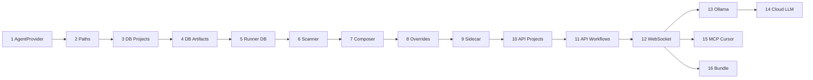

# Pulse — Roadmap de evolução arquitetural

Documento consolidado das decisões de arquitetura e plano de implementação em fases.
Cada fase corresponde a **um PR** com responsabilidade única e diff pequeno (~100–400 linhas).

---

## Contexto

O **pulse-cursor-task** é um orquestrador Python que executa workflows interativos (PRD, TechSpec, ADRs) via agentes de IA. Hoje opera como CLI terminal-first, acoplado ao Cursor, com paths hardcoded e artefatos salvos em disco.

### Estado atual

```
Flutter Desktop (futuro)
        ↕ (ainda não existe)
cursor-task CLI / biblioteca Python
        ↕
Executores Cursor (SDK, ACP, stream-cli)
        ↕
Skills em references/ + artefatos em .workflow/tasks/
```

### Estado alvo

```
Flutter Desktop
        ↕ REST + WebSocket (localhost)
Sidecar Python (pulse-orchestrator)
        ├── Workflow Engine (skills, fases, aprovação)
        ├── ProjectContextScanner (re-sync a cada workflow)
        ├── ArtifactRepository (SQLite)
        ├── Project Registry
        └── AgentProviders (Cursor, Ollama, OpenAI, Anthropic...)
                ↕
        project_path dinâmico (filesystem do usuário)
```

---

## Decisões de arquitetura

| # | Decisão | Detalhe |
|---|---------|---------|
| 1 | **Sidecar local** | FastAPI + WebSocket em `127.0.0.1`; Flutter não fala com LLMs diretamente |
| 2 | **Multi-LLM** | Contrato `AgentProvider`; Cursor primeiro; Ollama valida abstração; cloud depois |
| 3 | **Paths dinâmicos** | `project_path` por projeto, registrado no SQLite; sem defaults hardcoded |
| 4 | **Artefatos no DB** | SQLite como fonte da verdade para PRD, TechSpec e ADRs; export `.md` opcional |
| 5 | **Rules/tools sem cache** | Re-scan do filesystem no início de **cada workflow**; DB guarda só overrides (toggles) |
| 6 | **Três camadas de contexto** | Pulse (skills globais) → Projeto (rules/tools) → Tarefa (artefatos do DB) |
| 7 | **Instalação transparente** | Sidecar embarcado via PyInstaller no bundle Flutter; Lifecycle Manager sobe o processo |
| 8 | **PRs pequenos** | Uma responsabilidade por fase; ideal < 250 linhas de diff |

### Precedência de contexto

```
Tarefa (artefatos DB)  >  Projeto (rules/tools scan)  >  Pulse (skills, hard-gates)
```

Hard-gates do orquestrador (ex.: não salvar PRD sem aprovação) **nunca** são sobrescritos por rules do projeto.

### O que fica no DB vs filesystem

| Dado | Onde |
|------|------|
| Rules, skills locais, MCP, tools | Filesystem — re-scan a cada workflow |
| PRD, TechSpec, ADRs | SQLite — versionados |
| Projetos (`local_path`, nome) | SQLite |
| Overrides (rule/MCP desabilitados) | SQLite — só toggles, sem conteúdo |

### Descoberta de contexto do projeto (scanner)

Arquivos lidos a cada workflow:

**Rules**

| Arquivo / pasta | Prioridade |
|-----------------|------------|
| `.pulse/rules/**` | Alta (convenção Pulse) |
| `.cursor/rules/**/*.mdc` | Alta |
| `.cursor/rules/**/*.md` | Alta |
| `AGENTS.md` | Alta |
| `.cursorrules` | Média |
| `CLAUDE.md` | Média |
| `.github/copilot-instructions.md` | Baixa |

**Skills locais**

| Local |
|-------|
| `.pulse/skills/**/SKILL.md` |
| `.cursor/skills/**/SKILL.md` |

**Tools / MCP**

| Arquivo |
|---------|
| `.pulse/mcp.json` |
| `.cursor/mcp.json` |
| `mcp.json` (raiz) |
| `.pulse/tools.yaml` |

---

## Diagrama de dependências entre fases



Fases 13–15 paralelizáveis após a 12. Fase 16 depende da 12.

---

## Fases de implementação

### Fase 1 — Contrato `AgentProvider`

**PR:** `refactor: extrair contrato AgentProvider dos executores Cursor`

**Responsabilidade:** renomear a abstração sem mudar comportamento.

**Tasks:**

- [ ] Renomear `CursorExecutor` → `AgentProvider` em `executor/base.py`
- [ ] Atualizar `SdkExecutor`, `AcpCliExecutor`, `StreamCliExecutor`
- [ ] Atualizar `factory.py` e imports
- [ ] Garantir que testes existentes passam sem alteração de comportamento

**Entrega:** ~150 linhas. Zero feature nova.

**Fora de escopo:** novos providers, API, DB.

---

### Fase 2 — Paths dinâmicos obrigatórios

**PR:** `refactor: remover paths hardcoded e exigir project_path`

**Responsabilidade:** eliminar fallback silencioso de `DEFAULT_PROJECT_PATH` e `DEFAULT_ARTIFACTS_PATH`.

**Tasks:**

- [ ] Remover ou tornar `None` as constantes hardcoded em `types.py`
- [ ] Validar `project_path` obrigatório em `RunCursorTaskOptions` e CLI
- [ ] Mensagem de erro clara quando path ausente ou inválido
- [ ] Atualizar testes para paths explícitos via `tempfile`
- [ ] Atualizar README

**Entrega:** ~80–120 linhas.

**Depende de:** Fase 1.

---

### Fase 3 — SQLite: entidade Project

**PR:** `feat: persistência de projetos em SQLite`

**Responsabilidade:** CRUD de projetos — sem artefatos ou API.

**Tasks:**

- [ ] Adicionar `sqlalchemy`, `alembic` ao `pyproject.toml`
- [ ] Criar `persistence/` com session e base
- [ ] Model + migration: `projects` (`id`, `name`, `local_path`, `created_at`, `last_opened_at`)
- [ ] `ProjectRepository`: `create`, `get`, `list`, `delete`
- [ ] Testes unitários com SQLite in-memory

**Entrega:** ~200 linhas.

**Depende de:** Fase 2.

---

### Fase 4 — SQLite: workflows e artefatos

**PR:** `feat: schema de workflows e artefatos versionados`

**Responsabilidade:** modelagem e repositório — sem integrar ao runner.

**Tasks:**

- [ ] Migration: `workflows` (`id`, `project_id`, `slug`, `kind`, `status`, `provider`, `model`)
- [ ] Migration: `artifacts` (`id`, `workflow_id`, `kind`, `content`, `version`, `status`, timestamps)
- [ ] `ArtifactRepository`: `save`, `get_latest`, `list_by_workflow`, `get_version`
- [ ] Testes de versionamento (v1 → v2 → get_latest)

**Entrega:** ~250 linhas.

**Depende de:** Fase 3.

---

### Fase 5 — Runner persiste artefatos no DB

**PR:** `feat: gravar PRD/TechSpec no banco após aprovação`

**Responsabilidade:** substituir disco como fonte da verdade na conclusão do workflow.

**Tasks:**

- [ ] Criar workflow record no início de `_run_task`
- [ ] Após aprovação, `ArtifactRepository.save()` em vez de `ArtifactWriter.write()`
- [ ] TechSpec: ler PRD de entrada via DB (fallback temporário para arquivo)
- [ ] `RunCursorTaskResult` retorna `artifact_id`
- [ ] Flag `--export-md` para dump opcional em disco
- [ ] Atualizar testes de `completion` e runner

**Entrega:** ~200 linhas.

**Depende de:** Fase 4.

---

### Fase 6 — Scanner de contexto do projeto

**PR:** `feat: scanner stateless de rules, skills e MCP`

**Responsabilidade:** descobrir contexto de IA no filesystem — sem composição de prompt.

**Tasks:**

- [ ] Criar `project_context/scanner.py`
- [ ] Descobrir rules, skills, MCP e tools declarativas (ver tabela acima)
- [ ] Dataclasses: `ProjectContext`, `Rule`, `McpServer`, `ToolDef`
- [ ] Fixture `tests/fixtures/sample-project/` + testes

**Entrega:** ~300 linhas. Função pura: `scan(local_path) -> ProjectContext`.

**Depende de:** Fase 2.

---

### Fase 7 — Compositor de contexto no workflow

**PR:** `feat: re-sync de contexto e composição de prompt por workflow`

**Responsabilidade:** integrar scanner ao início de cada execução.

**Tasks:**

- [ ] Criar `project_context/composer.py` — merge: skill Pulse + rules projeto + artefatos DB
- [ ] Chamar `scanner.scan(project_path)` no início de `_run_task`
- [ ] Substituir `augment_workflow_paths` por composição estruturada
- [ ] Truncamento por budget de tokens (ordem de prioridade documentada)
- [ ] Testes: alterar rule no fixture → prompt muda

**Entrega:** ~200 linhas.

**Depende de:** Fases 5 e 6.

---

### Fase 8 — Overrides de projeto

**PR:** `feat: overrides de rules e MCP por projeto`

**Responsabilidade:** preferências do usuário no DB — conteúdo continua vindo do scan.

**Tasks:**

- [ ] Migration: `project_settings` (`disabled_rules`, `disabled_mcp`, `provider_override`)
- [ ] `SettingsRepository` + merge pós-scan
- [ ] Testes: rule desabilitada não aparece no prompt

**Entrega:** ~150 linhas.

**Depende de:** Fases 3 e 7.

---

### Fase 9 — Sidecar: servidor mínimo

**PR:** `feat: sidecar HTTP com health check`

**Responsabilidade:** processo servível — sem workflows ainda.

**Tasks:**

- [ ] Adicionar `fastapi`, `uvicorn` ao `pyproject.toml`
- [ ] Criar `server/app.py` com `GET /health` → `{ status, version }`
- [ ] Entry point: `pulse-orchestrator serve --host 127.0.0.1 --port 8765`
- [ ] Inicializar DB na subida do servidor
- [ ] Manter `cursor-task` CLI como alias legado

**Entrega:** ~120 linhas.

**Depende de:** Fase 3.

---

### Fase 10 — API REST de projetos

**PR:** `feat: REST CRUD de projetos`

**Responsabilidade:** expor projetos para o Flutter.

**Tasks:**

- [ ] `POST /projects` — valida `local_path`
- [ ] `GET /projects`, `GET /projects/{id}`, `DELETE /projects/{id}`
- [ ] `GET /projects/{id}/context/preview` — scanner on-demand
- [ ] `PATCH /projects/{id}/settings` — overrides
- [ ] Testes com `TestClient` FastAPI

**Entrega:** ~200 linhas.

**Depende de:** Fases 6, 8, 9.

---

### Fase 11 — API de workflows (REST)

**PR:** `feat: iniciar workflow via REST`

**Responsabilidade:** disparar PRD/TechSpec e consultar status — streaming na fase seguinte.

**Tasks:**

- [ ] `POST /workflows` — `{ project_id, kind, prompt?, prd_artifact_id? }`
- [ ] Executar runner em thread/async; status `pending → running → completed | failed`
- [ ] `GET /workflows/{id}` — status + `artifact_id`
- [ ] `GET /artifacts/{id}` — conteúdo markdown
- [ ] Re-sync de contexto no POST

**Entrega:** ~250 linhas. Limitação conhecida: perguntas interativas bloqueiam até Fase 12.

**Depende de:** Fases 5, 7, 10.

---

### Fase 12 — WebSocket para streaming e perguntas

**PR:** `feat: WebSocket de sessão interativa`

**Responsabilidade:** desacoplar UI do terminal — habilita Flutter.

**Tasks:**

- [ ] Protocolo de eventos: `status`, `output`, `thinking`, `question`, `success`, `error`
- [ ] `WebSocketStreamRenderer` implementa `StreamRenderer`
- [ ] `WebSocketQuestionHandler` aguarda `{ type: "answer" }`
- [ ] `WS /workflows/{id}/stream`
- [ ] Refatorar runner para renderer/handler injetados
- [ ] Teste de integração com cliente WS fake

**Entrega:** ~300 linhas.

**Depende de:** Fase 11.

**Contrato WebSocket:**

```
Servidor → Cliente:
  { "type": "status",   "message": "..." }
  { "type": "output",   "text": "...", "delta": true }
  { "type": "thinking", "text": "..." }
  { "type": "question", "text": "...", "options": ["A) ...", "B) ..."] }
  { "type": "success",  "artifact_id": "...", "output_file": "..." }
  { "type": "error",    "message": "..." }

Cliente → Servidor:
  { "type": "answer", "text": "A) Aprovado" }
```

---

### Fase 13 — Provider Ollama + WorkspaceTools

**PR:** `feat: provider Ollama com tools de workspace`

**Responsabilidade:** primeiro provider não-Cursor — valida abstração da Fase 1.

**Tasks:**

- [ ] `workspace/tools.py`: `read_file`, `grep`, `list_dir` (sandboxed em `project_path`)
- [ ] `providers/ollama.py` implementa `AgentProvider`
- [ ] Factory: `--provider ollama`
- [ ] Tool catalog para Ollama
- [ ] Testes com mock HTTP

**Entrega:** ~350 linhas.

**Depende de:** Fases 1, 7.

---

### Fase 14 — Provider OpenAI ou Anthropic

**PR:** `feat: provider cloud com function calling`

**Responsabilidade:** provider cloud — reutiliza `WorkspaceTools` da Fase 13.

**Tasks:**

- [ ] `providers/openai.py` ou `providers/anthropic.py` (um por PR)
- [ ] Mapear tool catalog → function definitions
- [ ] Credencial via env
- [ ] `--provider openai` na CLI e no `POST /workflows`

**Entrega:** ~300 linhas. Split em 14a/14b se ambos forem necessários.

**Depende de:** Fase 13.

---

### Fase 15 — MCP do projeto no provider Cursor

**PR:** `feat: carregar MCP servers do scan na sessão Cursor`

**Responsabilidade:** conectar MCP descobertas ao executor Cursor.

**Tasks:**

- [ ] `tool_catalog.py` — normaliza MCP do `ProjectContext`
- [ ] Preencher `mcpServers` em `AcpCliExecutor` (hoje `[]`)
- [ ] Passar `ProjectContext` via `ExecutionContext`
- [ ] Teste manual documentado no PR

**Entrega:** ~150 linhas.

**Depende de:** Fases 6, 12.

---

### Fase 16 — Empacotamento do sidecar

**PR:** `feat: binário standalone do sidecar via PyInstaller`

**Responsabilidade:** preparar bundle para Flutter.

**Tasks:**

- [ ] `packaging/pyinstaller.spec`
- [ ] `scripts/build-sidecar.sh` (macOS primeiro)
- [ ] `/health` retorna versão semver
- [ ] Documentar paths de embarque no Flutter
- [ ] CI: build smoke test

**Entrega:** ~100 linhas de config + script.

**Depende de:** Fase 12.

---

## Track Flutter (repositório separado)

Depende da Fase 12+.

| PR | Conteúdo |
|----|----------|
| F1 | `OrchestratorLifecycle` — sobe sidecar, health check |
| F2 | Onboarding — provider, API key, primeiro projeto |
| F3 | Lista projetos + preview de context (`GET .../context/preview`) |
| F4 | Tela workflow — WebSocket chat + perguntas A/B/C/D |
| F5 | Visualização de artefatos versionados |
| F6 | Bundle sidecar no instalador (DMG / MSI / AppImage) |

### Experiência de instalação (alvo)

1. Usuário baixa instalador único (~120 MB)
2. Instala normalmente (sem Python, pip ou CLI manual)
3. Primeira execução: wizard (provider, API key, pasta do projeto)
4. Sidecar sobe automaticamente em `127.0.0.1`
5. Uso diário: abrir app → sidecar inicia → workflow com re-sync de contexto

Dados do usuário: `~/Library/Application Support/Pulse/` (macOS), `%APPDATA%\Pulse\` (Windows), `~/.local/share/pulse/` (Linux).

---

## Schema SQLite (referência)

```sql
projects (
  id, name, local_path, created_at, last_opened_at
)

project_settings (
  project_id,
  disabled_rules JSON,
  disabled_mcp JSON,
  provider_override TEXT
)

workflows (
  id, project_id, slug, kind, status, provider, model, created_at
)

artifacts (
  id, workflow_id, kind, content, version, status, created_at, approved_at
)
```

Rules e tools **não** têm tabela de cache — apenas toggles em `project_settings`.

---

## Critérios de revisão por PR

- [ ] Uma responsabilidade — descritível em uma frase
- [ ] Diff < ~400 linhas (ideal < 250)
- [ ] Testes cobrindo comportamento novo
- [ ] CLI existente não quebra (breaking change documentado só na Fase 2)
- [ ] Sem escopo extra — se crescer, dividir fase

---

## Resumo

| Fase | PR em uma linha | Linhas ~ | Depende de |
|------|-----------------|----------|------------|
| 1 | Contrato AgentProvider | 150 | — |
| 2 | Paths dinâmicos | 100 | 1 |
| 3 | DB projects | 200 | 2 |
| 4 | DB artifacts | 250 | 3 |
| 5 | Runner → DB | 200 | 4 |
| 6 | Scanner rules/tools | 300 | 2 |
| 7 | Composer + re-sync | 200 | 5, 6 |
| 8 | Overrides toggles | 150 | 3, 7 |
| 9 | Sidecar health | 120 | 3 |
| 10 | REST projects | 200 | 6, 8, 9 |
| 11 | REST workflows | 250 | 5, 7, 10 |
| 12 | WebSocket | 300 | 11 |
| 13 | Ollama + tools | 350 | 1, 7 |
| 14 | Cloud LLM | 300 | 13 |
| 15 | MCP Cursor | 150 | 6, 12 |
| 16 | PyInstaller | 100 | 12 |

**Ordem de execução:** `1 → 2 → 3 → 4 → 5 → 6 → 7 → 8 → 9 → 10 → 11 → 12`, depois `13 → 14`, `15` e `16` em paralelo.
