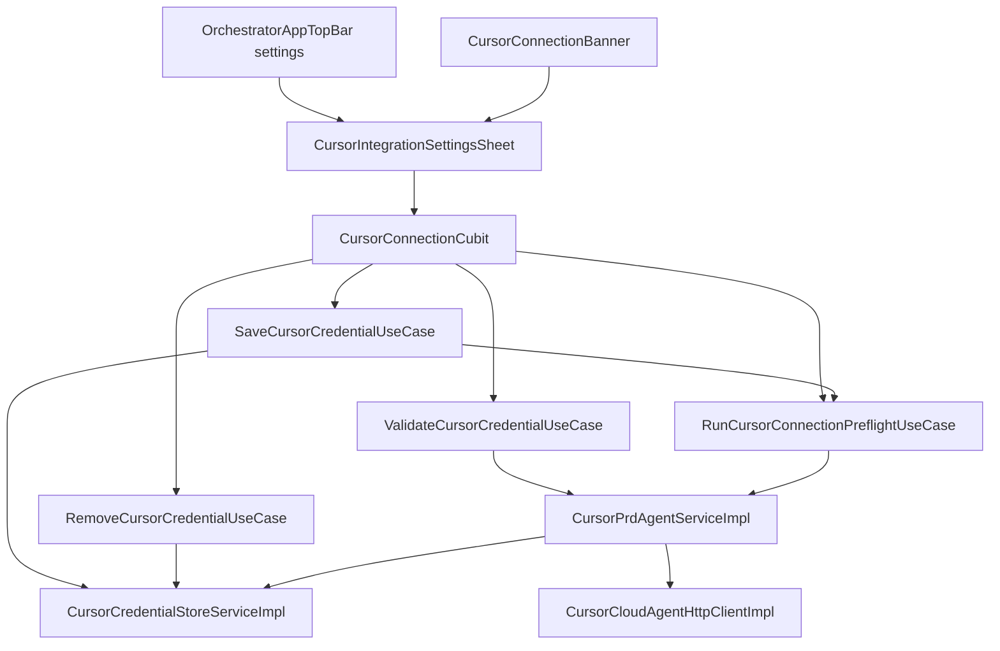

# TechSpec: Register Cursor Integration Token

## Executive Summary

Pulse already persists Cursor credentials in `FlutterSecureStorage`, validates via `GET /v1/me`, gates PRD runs in domain, and shows a connection banner—but there is no UI to write, test, rotate, or remove the key, and banner/settings entry points are placeholders. This delivery adds a **shared modal settings sheet** (gear + banner CTA), extends **`CursorConnectionCubit`** for test-gated save and remove-with-confirm, and introduces **draft credential validation** without persisting until save.

**Primary trade-off:** Modal presentation avoids new routes (faster MVP, no deep links) in exchange for no bookmarkable settings URL until a future routed settings page.

**Out of scope (explicit):** Wiring `PrdWorkflowCubit.startRun()` in UI; that remains a separate task. Existing `PrdReviewCubit` approve gate and `StartPrdAgentRunUseCase` domain gate stay as-is.

## System Architecture

### Component Overview



| Component | Layer | Responsibility |
|-----------|-------|----------------|
| `CursorIntegrationSettingsSheet` | presentation | Masked input (`TextEditingController` local), Test/Save/Remove actions, doc link, opens confirm dialog on remove |
| `CursorIntegrationRemoveConfirmDialog` | presentation | Destructive confirm before delete |
| `CursorConnectionCubit` (extended) | presentation | Global connection status + settings session (`isDraftTestPassed`, operation status) |
| `CursorConnectionBannerPolicy` | presentation | Show banner for `disconnected` and `failure` |
| `ValidateCursorCredentialUseCase` | domain | Preflight draft key without store write |
| `SaveCursorCredentialUseCase` | domain | `write()` stored credential |
| `RemoveCursorCredentialUseCase` | domain | `delete()` stored credential |
| `RunCursorConnectionPreflightUseCase` | domain | Existing stored-credential preflight |
| `CursorPrdAgentService.preflightCredential` | domain/service | `GET /v1/me` with explicit API key |
| `CursorCredentialStoreService` | domain/service | Existing secure storage contract |
| `OrchestratorComposition` | app/di | Wire new use cases into cubit |

**Data flow — save:** User pastes key → Test → `ValidateCursorCredentialUseCase` → cubit sets `isDraftTestPassed` → Save enabled → `SaveCursorCredentialUseCase` → `runPreflight()` → `connected`, banner hidden.

**Data flow — remove:** Remove → confirm dialog → `RemoveCursorCredentialUseCase` → `runPreflight()` → `disconnected` or `failure`, banner shown per policy.

**External:** Cursor Cloud Agents API `https://api.cursor.com/v1/me` (Basic auth `apiKey:`).

## Implementation Design

### Core Interfaces

```dart
abstract interface class CursorPrdAgentService {
  Future<Either<Failure, void>> preflight();
  Future<Either<Failure, void>> preflightCredential(String apiKey);
  // existing startRun, watchRun, cancelRun unchanged
}
```

```dart
final class ValidateCursorCredentialUseCase {
  ValidateCursorCredentialUseCase({required CursorPrdAgentService agent});
  Future<Either<Failure, void>> call(String apiKey);
}

final class SaveCursorCredentialUseCase {
  SaveCursorCredentialUseCase({required CursorCredentialStoreService store});
  Future<void> call(String apiKey);
}

final class RemoveCursorCredentialUseCase {
  RemoveCursorCredentialUseCase({required CursorCredentialStoreService store});
  Future<void> call();
}
```

```dart
enum CursorSettingsOperationStatus { idle, testing, saving, removing }

final class CursorConnectionState {
  final CursorConnectionStatus status;
  final String? remediationMessage;
  final bool isDraftTestPassed;
  final CursorSettingsOperationStatus settingsOperation;
  final String? settingsFeedbackMessageKey;
}
```

Error handling: reuse `CursorConnectionFailure` codes for test/preflight; map to PT-BR string keys in cubit (never log or emit full API key).

### Data Models

No new persistent entities. Storage remains single key `cursor_prd_agent_credential` in `CursorCredentialStoreServiceImpl`.

| Field / concept | Location | Notes |
|-----------------|----------|-------|
| Draft API key | Widget `TextEditingController` only | Cleared on modal close; not in cubit state |
| `isDraftTestPassed` | `CursorConnectionState` | Reset on `resetSettingsSession()` and when draft text changes |
| Connection status | Existing `CursorConnectionStatus` | Banner + review gate consume unchanged enum |

### API Endpoints

Not applicable (client calls existing Cursor API). Relevant call:

| Method | Path | Purpose |
|--------|------|---------|
| GET | `/v1/me` | Validate draft or stored credential |

## Integration Points

| Service | Integration | Auth | Errors |
|---------|-------------|------|--------|
| Cursor Cloud Agents | `CursorCloudAgentHttpClient` | Basic `base64(apiKey:)` | 401 → `unauthorized`; 5xx → `network`; other non-2xx → `unknown` |

**Draft validation implementation:** Add optional credential parameter to HTTP `get` path or dedicated internal method on `CursorPrdAgentServiceImpl` that builds Authorization without reading store—avoid temporary write-to-store.

**Retry:** Reuse `TransientHttpRetry` for draft test and preflight.

**Doc link:** External URL constant in strings (official Cursor Cloud Agents / API key documentation).

## Impact Analysis

| Component | Impact Type | Description and Risk | Required Action |
|-----------|-------------|---------------------|-----------------|
| `CursorPrdAgentService` + impl | modified | New `preflightCredential` | Update interface, impl, stub, fakes, tests |
| `CursorCloudAgentHttpClient` impl | modified | Support one-off auth for draft GET | Unit test with fake store |
| `CursorConnectionCubit` / state | modified | Settings methods and flags | Extend tests in `cursor_connection_cubit_test.dart` |
| `CursorConnectionBannerPolicy` | modified | Show on `failure` | Update policy test |
| `OrchestratorStrings` | modified | Settings form, buttons, errors, remove confirm, doc link label | PT-BR only; strings test |
| `orchestrator_page.dart` | modified | Wire settings + banner callbacks | Replace settings `onPlaceholder` |
| `OrchestratorAppTopBar` | modified | Accept `onOpenCursorSettings` callback | Pass from page |
| `workflow_prd_workspace.dart` | modified | Pass `onOpenCursorSettings` | Already has param; wire parent |
| `OrchestratorComposition` | modified | Register use cases, inject into cubit | DI test if present |
| `PrdReviewCubit` | unchanged | Already syncs gate | Verify preflight after save |
| `StartPrdAgentRunUseCase` | unchanged | Domain gate | No change this task |
| Router (`RoutePaths`) | unchanged | Modal only per ADR-002 | None |

## Testing Approach

### Unit Tests

| Target | Scenarios |
|--------|-----------|
| `ValidateCursorCredentialUseCase` | Success; 401; 5xx; empty key |
| `SaveCursorCredentialUseCase` / `RemoveCursorCredentialUseCase` | Writes/deletes via fake store |
| `CursorPrdAgentServiceImpl.preflightCredential` | Maps status codes like `preflight()` |
| `CursorConnectionCubit` | `testDraftCredential` sets flag; save blocked without test; save clears flag and runs preflight; remove resets; `resetSettingsSession` |
| `CursorConnectionBannerPolicy` | `failure` and `disconnected` → show; `connected` → hide |
| `OrchestratorStrings` | New keys non-empty PT-BR |

Use existing fakes: `FakeCursorCredentialStoreService`, `FakeCursorCloudAgentHttpClient`.

### Integration Tests

Omitted for MVP (project defers widget tests unless second-order). Manual test plan in task breakdown.

## Development Sequencing

### Build Order

1. **`preflightCredential` on service + HTTP auth override** — no UI dependency; enables draft validation.
2. **Domain use cases** (`Validate`, `Save`, `Remove`) — depends on step 1 for validate; save/remove only need store.
3. **DI wiring in `OrchestratorComposition`** — depends on step 2.
4. **Extend `CursorConnectionState` + `CursorConnectionCubit`** — depends on step 3.
5. **`CursorConnectionBannerPolicy` + tests** — depends on step 4 (status semantics unchanged but policy expands).
6. **`OrchestratorStrings` + strings tests** — depends on copy list from PRD flows; can parallelize with 5 after keys are known.
7. **`CursorIntegrationSettingsSheet` + remove confirm dialog** — depends on steps 4 and 6.
8. **Wire orchestrator page / top bar / workspace callbacks** — depends on step 7.
9. **`flutter analyze` + `dart format` + full unit test run** — depends on all above.

### Technical Dependencies

- `flutter_secure_storage` already in project.
- Network access to `api.cursor.com` for manual validation.
- No new packages.

## Monitoring and Observability

- **Do not log** API keys, Authorization headers, or draft input.
- Optional debug logs: connection status transitions only (`connected` / `disconnected` / `failure` code enum), behind existing logging patterns if any.
- No new analytics events in MVP.

## Technical Considerations

### Key Decisions

| Decision | Rationale | Trade-off |
|----------|-----------|-----------|
| Modal sheet (ADR-002) | Matches desktop orchestrator; no router churn | No deep link |
| Test-gated save (ADR-003) | PRD + user choice; invalid keys never stored | Extra use case + HTTP override |
| Extend `CursorConnectionCubit` (ADR-006) | Single connection source of truth | Cubit size growth |
| Banner on `failure` (ADR-004) | Discoverability for bad stored keys | More visible banner |
| Settings-only scope | Domain gate exists; start UI separate | PRD “start blocked” UI incomplete until follow-up task |
| Strings in `OrchestratorStrings` | Existing cursor copy location | Large strings class; split later if needed |

### Known Risks

| Risk | Mitigation |
|------|------------|
| Draft key in memory | Controller disposed on close; no cubit persistence |
| Stub/fake drift | Update `CursorPrdAgentServiceStub.preflightCredential` to mirror store read |
| Settings gear still triggers other placeholders | Only replace settings icon handler; leave workspaces/help placeholders |
| Masked field shows nothing after save | UI shows “configured” label without reveal; rotate = paste new key |

## Architecture Decision Records

- [ADR-001: Hybrid Cursor Credential Entry via Shared Settings Surface](adrs/adr-001.md) — Single settings surface from gear and banner; no wizard.
- [ADR-002: Cursor Settings as Modal Sheet Without Dedicated Route](adrs/adr-002.md) — Modal presentation; no `RoutePaths` in MVP.
- [ADR-003: Test-Gated Save with Draft Credential Validation](adrs/adr-003.md) — Draft `preflightCredential`; save only after successful test in session.
- [ADR-004: Connection Banner Visible for Disconnected and Failure](adrs/adr-004.md) — Banner policy includes invalid/network states.
- [ADR-005: Confirmation Dialog Before Credential Removal](adrs/adr-005.md) — Confirm before `delete()`.
- [ADR-006: Settings Orchestration in CursorConnectionCubit](adrs/adr-006.md) — Extended cubit orchestrates test/save/remove and preflight refresh.
