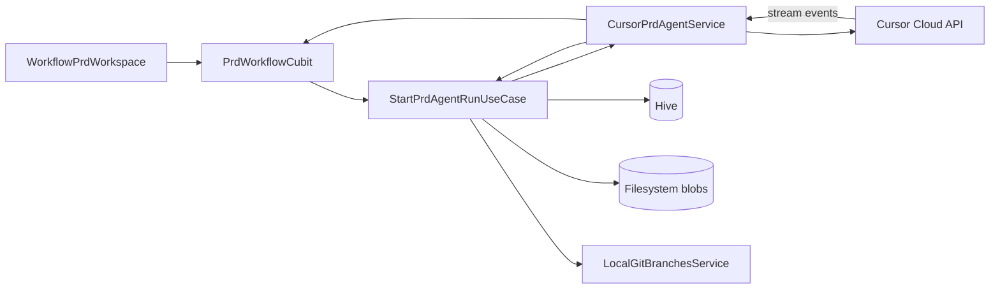

# TechSpec: Cursor PRD Specialist Agent

## Executive Summary

This TechSpec implements the PRD-phase MVP from `_prd.md` inside the existing Flutter orchestrator feature. Pulse becomes the system of record for PRD workflows keyed by **mapped project UUID + workflow slug**, with a **hybrid Cursor runtime** (cloud agent API + local repo/branch context), **Hive-indexed metadata**, **filesystem markdown blobs**, live execution streaming in-app, **inline PRD editing**, and **automatic re-run on reject with feedback**.

The primary trade-off is **cloud dependency for agent execution** in exchange for a supported streaming and lifecycle API, while local Git and sandbox services remain the source of truth for repository context. YAGNI scope: no TechSpec/Tasks agents, no Git export, no GoRouter migration, and no new top-level feature package—extend `lib/features/orchestrator/` only.

## System Architecture

### Component Overview

| Component | Layer | Responsibility |
|-----------|-------|----------------|
| `WorkflowPrdWorkspace` | presentation | PRD-only workspace: stepper, stream panel, review/editor, approve/reject/cancel |
| `PrdWorkflowCubit` | presentation | Phase status, active run binding, stream subscription lifecycle |
| `PrdReviewCubit` | presentation | Draft load, dirty editor state, save/approve/reject actions |
| `CursorConnectionCubit` | presentation | Preflight connection status for onboarding banner |
| Workflow / artifact use cases | domain | Create slug, start/cancel run, persist stream, approve, reject+auto-rerun |
| `WorkflowRepository`, `ArtifactRepository`, `PrdRunRepository` | domain | Contracts for Hive + filesystem coordination |
| `CursorPrdAgentService` | domain/service | Port: enqueue run, subscribe stream, cancel; hides HTTP/SSE |
| `CursorPrdAgentServiceImpl` | service | Cloud API client + `PrdRunContextBuilder` (local path, branch) |
| Hive boxes + adapters | data | Workflows, runs, stream index, approval metadata |
| `FilesystemArtifactStore` | data | `prd.md`, `adrs/`, optional stream JSONL archives |
| `RecentProjectsRepository` (v2) | data | UUID `projectId`, `canonicalPath`, migration from v1 |
| `OrchestratorCompositionScope` | app/di | Wire Hive init, repos, services, cubits |

**Data flow (happy path):**

1. User selects mapped project → creates **slug** + directive + branch → `CreateWorkflowUseCase`.
2. Preflight `CursorConnectionCubit` → `StartPrdAgentRunUseCase` builds context → `CursorPrdAgentService.startRun`.
3. SSE/stream events → `AppendStreamEventUseCase` → Hive index + optional JSONL; `PrdWorkflowCubit` emits UI lines.
4. Run completes → agent output written to `prd.md` + `adrs/` → status `pendingApproval`.
5. User edits in `PrdReviewCubit` → `SavePrdDraftUseCase` → filesystem.
6. User **approves** → `ApprovePrdUseCase` updates Hive metadata; phase `approved`. TechSpec workspace stays locked/coming-soon per ADR-002.

**External interaction:** Cursor Cloud Agents API only (no writes to imported Git tree).



## Implementation Design

### Core Interfaces

```dart
abstract interface class CursorPrdAgentService {
  Future<PrdRunEntity> startRun(PrdRunRequest request);
  Stream<PrdStreamEvent> watchRun(String cloudRunId);
  Future<void> cancelRun(String cloudRunId);
}

class PrdRunRequest {
  const PrdRunRequest({
    required this.projectId,
    required this.slug,
    required this.repoPath,
    required this.branchName,
    required this.directive,
    this.feedback,
    this.supersedesRunId,
  });

  final String projectId;
  final String slug;
  final String repoPath;
  final String branchName;
  final String directive;
  final String? feedback;
  final String? supersedesRunId;
}
```

```dart
abstract interface class WorkflowRepository {
  Future<WorkflowEntity> create({
    required String projectId,
    required String slug,
    required String branchName,
    String? directive,
  });
  Future<List<WorkflowEntity>> listByProject(String projectId);
  Future<WorkflowEntity?> findBySlug({
    required String projectId,
    required String slug,
  });
}
```

```dart
abstract interface class ArtifactRepository {
  Future<String> readPrdMarkdown({
    required String projectId,
    required String slug,
  });
  Future<void> writePrdMarkdown({
    required String projectId,
    required String slug,
    required String markdown,
    required PrdArtifactMetadata metadata,
  });
  Future<List<AdrEntry>> listAdrs({
    required String projectId,
    required String slug,
  });
}
```

**Error handling:** Use cases return `Either<Failure, T>` via `fpdart` where the orchestrator already adopts typed failures; map cloud/network errors to `CursorConnectionFailure`, `PrdRunFailure`, and `ArtifactPersistenceFailure` without exposing SDK payloads in UI.

### Data Models

**Hive entities (index):**

| Model | Key fields |
|-------|------------|
| `WorkflowEntity` | `projectId`, `slug` (unique per project), `branchName`, `directive`, `prdPhaseStatus`, `createdAt` |
| `PrdRunEntity` | `id`, `workflowKey`, `cloudRunId`, `status` (queued/running/completed/failed/cancelled), `supersedesRunId`, `feedback`, `startedAt`, `endedAt` |
| `PrdApprovalEntity` | `workflowKey`, `status` (draft/pendingApproval/approved), `approvedAt`, `lastEditedAt`, `sourceRunId` |
| `StreamEventEntity` | `runId`, `sequence`, `eventType`, `payloadSummary`, `timestamp` |

**Filesystem layout** (`path_provider` application support):

```text
pulse/workflows/{projectId}/{slug}/
  prd.md
  adrs/adr-NNN.md
  streams/{runId}.jsonl   # optional archival
```

**Recent projects v2** (`RecentProjectsDocument`):

- `schemaVersion: 2`
- `LocalProjectEntity`: `id` (UUID), `canonicalPath`, `displayName`, `lastAccessedAt`, `macosSecurityScopedBookmark`

**Slug rules:** kebab-case validation, uniqueness enforced in `CreateWorkflowUseCase` via Hive query.

### API Endpoints

Not applicable for REST surface in Pulse desktop MVP. Internal **Cursor Cloud Agents API** (exact paths from Cursor SDK docs) behind `CursorPrdAgentServiceImpl`:

| Operation | Purpose |
|-----------|---------|
| Create/start agent run | Enqueue PRD specialist with composed prompt |
| Stream run events | SSE → `PrdStreamEvent` mapping |
| Cancel run | User cancel in-flight |

Authentication: API key or token in secure storage (platform-specific); never persisted in Hive, filesystem artifacts, or stream payloads.

## Integration Points

| System | Integration | Auth | Errors / retry |
|--------|-------------|------|----------------|
| Cursor Cloud Agents | PRD specialist run + stream | User-provided credential via settings; preflight status | Exponential backoff on 5xx; fail fast on 401 with PT-BR remediation copy |
| Local Git (`git2dart`) | Branch list and validation | macOS sandbox bookmark on repo path | Existing `LocalGitBranchesResult` mapping |
| Hive | Workflow/run index | Local app data | Box open failures → blocking error screen |
| Filesystem | PRD/ADR blobs | App sandbox | Atomic write: temp file → rename; rollback Hive on failure |

## Impact Analysis

| Component | Impact Type | Description and Risk | Required Action |
|-----------|-------------|---------------------|-----------------|
| `recent_projects_document.dart` | modified | v2 UUID migration | Migration use case + tests |
| `InitializeAgentSubmitHandler` | modified | Route to PRD workspace, not TechSpec | Change handler + cubit view enum |
| `OrchestratorMainContentCubit` | modified | Add `prdWorkflow` view | State + tests |
| `recent_projects_sidebar.dart` | modified | Populate agents from `listByProject` | Wire use case |
| `initialize_agent_modal.dart` | modified | Slug field + uniqueness validation | UI + strings PT-BR |
| `workflow_techspec_workspace.dart` | modified | Locked until PRD approved for slug | Gate on `prdPhaseStatus` |
| `orchestrator_composition.dart` | modified | Hive, repos, Cursor service | Register providers |
| `pubspec.yaml` | modified | Add `hive`, `hive_flutter`, `fpdart` if missing | `flutter pub get` |
| New PRD widgets/cubits | new | Stream, editor, connection banner | Follow DS tokens, no `setState` |
| Router | none (MVP) | State in cubit on `/orchestrator` | Optional future `RoutePaths` |

## Testing Approach

### Unit Tests

- **Domain use cases:** create workflow (slug collision), start/cancel run, append stream, approve, reject triggers auto-rerun with `supersedesRunId`, save edited PRD.
- **Repositories:** Hive + filesystem consistency (pointer matches file), migration v1→v2 UUID.
- **Services:** `CursorPrdAgentService` fake emitting deterministic stream events.
- **Cubits:** `bloc_test` for `PrdWorkflowCubit` state transitions; `PrdReviewCubit` dirty guard before overwrite on new run.
- **Coverage target:** ≥90% on new domain/data units per project rules.

### Integration Tests

- Deferred for widget layer per project workflow; optional later: fake Hive box + temp directory integration test for `ArtifactRepositoryImpl`.

**Critical scenarios:**

- Reject with feedback enqueues new run without extra click.
- Unsaved editor warning before new run overwrites `prd.md`.
- Cancel run mid-flight → status `cancelled`, stream stops.
- Cursor disconnected → start run blocked with remediation message.
- Approved PRD not writable to Git tree (verify no repo writes in service fakes).

## Development Sequencing

### Build Order

1. **Dependencies and Hive bootstrap** — add packages, init Hive in composition root; no feature dependencies.
2. **Recent projects v2 migration** — depends on step 1; UUID `projectId` for all downstream keys.
3. **Filesystem artifact store + path layout** — depends on step 2; write/read `prd.md` and `adrs/`.
4. **Hive workflow and run repositories** — depends on steps 1–3; CRUD workflows, runs, stream index.
5. **Domain use cases (workflow + artifact)** — depends on step 4; create slug, list by project, save draft.
6. **Cursor connection port + preflight cubit** — depends on step 1; blocks run start in UI.
7. **`CursorPrdAgentService` impl (hybrid)** — depends on steps 2, 5, 6; cloud run + local context builder.
8. **PRD run lifecycle use cases** — depends on step 7; start, stream append, complete, cancel, fail mapping.
9. **Reject + auto-rerun + approve use cases** — depends on step 8; includes ADR-007 lineage fields.
10. **`WorkflowPrdWorkspace` + cubits** — depends on steps 5–9; stepper, stream, inline editor (ADR-008).
11. **Wire orchestrator shell** — depends on step 10; modal slug, submit handler → PRD view, sidebar workflow list.
12. **Strings (PT-BR), unit tests, analyze/format** — depends on steps 1–11.

### Technical Dependencies

- Cursor Cloud Agents API availability and pilot API credentials.
- `hive` code generation/adapters registered before any repository use.
- macOS sandbox bookmark validity for Git branch reads (existing behavior).
- Design system tokens for new stream/review widgets (reuse `workflow*` tokens where possible).

## Monitoring and Observability

| Signal | Implementation |
|--------|----------------|
| PRD cycle time | `approvedAt - firstRunStartedAt` per workflow in Hive |
| Rework rate | Count runs where `supersedesRunId != null` before approval |
| Failure rate | `failed` runs / total runs per rolling window |
| Stream lag | Max gap between SSE receive and UI append (debug log field `streamLagMs`) |
| Logs | Structured info: `projectId`, `slug`, `runId`, `eventType`; never log secrets or full PRD body |

Alerts: not applicable for desktop MVP; surface failures in UI stream and status chips.

## Technical Considerations

### Key Decisions

| Decision | Rationale | Trade-off |
|----------|-----------|-----------|
| Hybrid Cursor runtime (ADR-004) | Supported agent + stream API | Requires network |
| Hive + filesystem (ADR-005) | Fast lists + readable markdown | Dual-store consistency discipline |
| UUID project id v2 (ADR-006) | Stable artifact keys | Migration effort |
| Auto re-run on reject (ADR-007) | Faster rework | Possible accidental runs; cancel mitigates |
| Inline PRD editor (ADR-008) | Minor fixes without agent | Dirty-state and overwrite rules |

### Known Risks

| Risk | Mitigation |
|------|------------|
| Cursor API changes | Single service port; adapter tests with recorded fixtures |
| Hive/filesystem drift | Repository writes ordered; integration test with temp dir |
| Large stream volume | Cap in-memory UI buffer; persist full history to JSONL |
| English PRD content vs PT-BR UI | Document language is team convention; UI strings stay PT-BR |
| `WorkflowTechspecWorkspace` placeholder confusion | Show PRD-approved gate; keep coming-soon for TechSpec |

**PRD open questions (resolved in this TechSpec):**

| # | Resolution |
|---|------------|
| 4 | Auto re-run after reject (ADR-007) |
| 5 | Inline edit before approval (ADR-008) |
| 2 | Fixed PRD specialist agent for MVP (configurable per project deferred) |
| 6 | Optional read-only repo path/branch in review header; no repo writes |

Remaining product questions (baseline metrics, credential ownership) stay in `_prd.md`; they do not block implementation contracts above.

## Architecture Decision Records

- [ADR-001: Native Pulse Cockpit for Cursor Workflow Orchestration](adrs/adr-001.md) — Pulse orchestrates runs, approval, and streaming.
- [ADR-002: PRD-Only MVP Scope](adrs/adr-002.md) — PRD phase first; later phases deferred.
- [ADR-003: Pulse-Internal Artifact Storage by Project and Slug](adrs/adr-003.md) — Artifacts live in Pulse keyed by project + slug.
- [ADR-004: Hybrid Cursor Runtime for PRD Agent Execution](adrs/adr-004.md) — Cloud agent API plus local repo/branch context services.
- [ADR-005: Hive-Indexed Artifact Store with Filesystem Markdown Blobs](adrs/adr-005.md) — Hive for index; disk for PRD/ADR content.
- [ADR-006: Stable Mapped Project Identity via UUID](adrs/adr-006.md) — Recent projects v2 migration from path-as-id.
- [ADR-007: Automatic PRD Re-run After Rejection with Feedback](adrs/adr-007.md) — Reject immediately enqueues a new run with feedback context.
- [ADR-008: Inline PRD Markdown Editing Before Approval](adrs/adr-008.md) — Users may edit `prd.md` in Pulse before approval.
