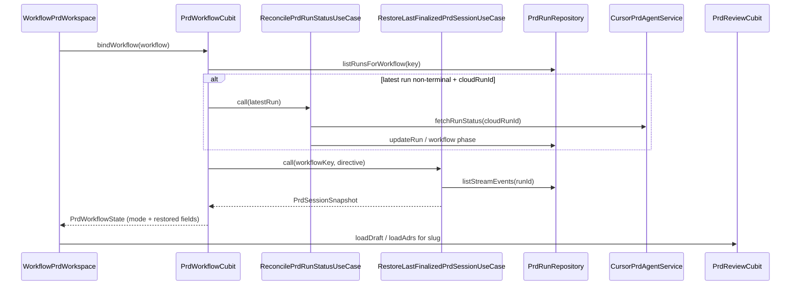

# TechSpec: Workflow Session Continuity (PRD Agent MVP)

## Executive Summary

Pulse.ai already persists PRD runs and stream events in Hive (and JSONL on disk), but `PrdWorkflowCubit.bindWorkflow` only restores workflow phase status—terminal logs and conversation appear empty after navigation or cold start. This TechSpec adds **automatic hydration of the latest terminal run** per `workflowKey` on PRD workflow open, with **cloud status reconciliation** when the latest run is still active, and presentation rules for in-progress-only, restore failure, and overlapping new runs.

**Approach:** Introduce `RestoreLastFinalizedPrdSessionUseCase` and `ReconcilePrdRunStatusUseCase`, extend `CursorPrdAgentService` with `fetchRunStatus`, and expand `PrdWorkflowState` with explicit session modes and restored snapshots. Conversation is **derived** from existing `StreamEventEntity` rows (ADR-002); no new transcript Hive box. Artifacts reuse disk paths under `{appSupport}/pulse/workflows/{projectId}/{slug}/`, keyed by `PrdApprovalEntity.sourceRunId` where available.

**Primary trade-off:** Per-run user prompt accuracy is limited to `workflow.directive` (workflow-level) plus `run.feedback`, avoiding a `PrdRunEntity` schema migration. Historical prompts may not match if the directive changed after the run.

## System Architecture

### Component Overview

| Component | Responsibility |
|-----------|----------------|
| `RestoreLastFinalizedPrdSessionUseCase` | Resolve latest terminal run for `workflowKey`; load events; build terminal lines + conversation models (capped). |
| `ReconcilePrdRunStatusUseCase` | If latest run is non-terminal with `cloudRunId`, call cloud GET; map to terminal status and update Hive/workflow phase. |
| `PrdStreamEventMapper` | Map `StreamEventEntity` / `PrdStreamEvent` → `PrdStreamLineUiModel` and `PrdConversationMessageUiModel` (shared live + restore). |
| `PrdWorkflowCubit` | On `bindWorkflow`, run reconcile then restore; manage `PrdSessionViewMode` and restored vs live buffers. |
| `CursorPrdAgentService.fetchRunStatus` | HTTP status poll for offline completion (ADR-003). |
| `WorkflowPrdWorkspace` | Render session modes: restored terminal, conversation column, in-progress affordance, new-run overlay banner, ADR cards. |
| `PrdReviewCubit` / `ListWorkflowAdrsUseCase` | Load PRD draft and ADR list for restored `sourceRunId` / workflow slug. |
| `PrdRunRepository` | Existing `listRunsForWorkflow`, `listStreamEvents`, `updateRun`—no schema change for MVP. |

**Data flow on open:**



## Implementation Design

### Core Interfaces

```dart
abstract interface class CursorPrdAgentService {
  Future<Either<Failure, void>> preflight();
  Future<Either<Failure, void>> preflightCredential(String apiKey);
  Future<PrdRunEntity> startRun(PrdRunContext context);
  Stream<PrdStreamEvent> watchRun(String cloudRunId);
  Future<void> cancelRun(String cloudRunId);
  Future<Either<Failure, CloudRunStatus>> fetchRunStatus(String cloudRunId);
}

final class CloudRunStatus {
  const CloudRunStatus({required this.mappedPrdRunStatus});
  final PrdRunStatus mappedPrdRunStatus;
}

abstract interface class RestoreLastFinalizedPrdSessionUseCase {
  Future<Either<Failure, PrdSessionSnapshot>> call(RestorePrdSessionRequest request);
}

final class PrdSessionSnapshot {
  const PrdSessionSnapshot({
    required this.runId,
    required this.runStatus,
    required this.terminalLines,
    required this.conversationMessages,
  });
  final String runId;
  final PrdRunStatus runStatus;
  final List<PrdStreamLineUiModel> terminalLines;
  final List<PrdConversationMessageUiModel> conversationMessages;
}
```

```dart
enum PrdSessionViewMode {
  empty,
  restored,
  inProgressOnly,
  restoreFailed,
  restoredWithActiveRun,
}
```

### Data Models

**Existing (unchanged schema):**

- `WorkflowKey` / `WorkflowEntity` — `projectId`, `slug`, `directive`, `prdPhaseStatus`.
- `PrdRunEntity` — `id`, `workflowKey`, `status`, `startedAt`, `endedAt`, `feedback`, `cloudRunId`.
- `StreamEventEntity` — `runId`, `sequence`, `eventType`, `payloadSummary`, `timestamp`.
- `PrdApprovalEntity.sourceRunId` — binds completed PRD artifact to a run.

**New presentation models:**

- `PrdConversationMessageUiModel` — `role` (`user` | `agent`), `displayText`, `timestamp`, `sequence`.
- `RestorePrdSessionRequest` — `workflowKey`, `workflowDirective`, optional `WorkflowEntity` for phase sync.

**Restore selection algorithm:**

1. `listRunsForWorkflow(workflowKey)` (descending `startedAt`).
2. If first run is non-terminal → reconcile (ADR-003); if still non-terminal → `inProgressOnly`, no snapshot.
3. Else first run where `status.isTerminal` → hydrate events; cap to last 200 by `sequence`.
4. If no terminal run → `empty` (distinct from `restoreFailed`).

**Conversation derivation (ADR-002):**

- User: `workflow.directive` (if non-empty) + optional `run.feedback` as separate user messages.
- Agent: stream events where `eventType` is `assistant` or `result` with non-empty `payloadSummary`.
- Exclude `thinking`, `tool_call`, `heartbeat` from conversation (remain in terminal only).

**Artifact binding:**

- PRD card: `PrdReviewCubit.loadDraft()` when phase is `draft` or `pendingApproval`; display `sourceRunId` from approval when restored run matches.
- ADR cards: wire `ListWorkflowAdrsUseCase` in `WorkflowPrdWorkspace` / new `PrdAdrListSection` showing files from `pulse/workflows/.../adrs/` (same run coherence via workflow slug; metadata `sourceRunId` when present).
- Missing file on disk: card shows PT-BR missing-artifact state (PRD risk mitigation).

### API Endpoints

| Method | Path | Purpose |
|--------|------|---------|
| GET | `/v1/agents/{agentId}/runs/{runId}` | Map cloud run status → `CloudRunStatus` / `PrdRunStatus` for reconciliation (new). |
| GET | `/v1/agents/{agentId}/runs/{runId}/stream` | Existing SSE (unchanged; not used on restore open). |
| POST | `/v1/agents/{agentId}/runs/{runId}/cancel` | Existing cancel (unchanged). |

Request/response mapping lives in `CursorPrdAgentServiceImpl` with unit tests mirroring `cursor_prd_agent_service_impl_test.dart` patterns.

## Integration Points

| System | Integration |
|--------|-------------|
| Cursor Cloud Agents API | `fetchRunStatus` on workflow open when latest local run is active and credentialed. |
| Hive (`pulse_prd_runs`, `pulse_stream_events`) | Read-only for restore; writes on reconcile completion via existing use cases. |
| Local filesystem artifacts | `FilesystemArtifactServiceImpl` paths; not `.compozy/tasks/` (product docs vs app storage—no path migration in MVP). |

**Auth:** Reuse `CursorCredentialStoreService` / connection gate; skip cloud reconcile if credential missing (local in-progress only).

**Errors:** Network/401 on reconcile → do not hydrate false terminal state; surface via `CursorConnectionBanner` where applicable. Restore failure → `restoreFailed` + PT-BR message key + retry calling `bindWorkflow` again.

## Impact Analysis

| Component | Impact Type | Description and Risk | Required Action |
|-----------|-------------|----------------------|-----------------|
| `PrdWorkflowCubit` | modified | Async `bindWorkflow`; dual buffers; new run overlay | Extend state, tests |
| `PrdWorkflowState` | modified | `PrdSessionViewMode`, restored fields | Update `copyWith`, tests |
| `WorkflowPrdWorkspace` | modified | Conversation list, modes, ADR section, banners | UI + strings PT-BR |
| `CursorPrdAgentService` (+ impl, stub, fake) | modified | `fetchRunStatus` | Implement + tests |
| `OrchestratorComposition` | modified | Register new use cases | DI wiring |
| `OrchestratorStrings` | modified | Empty, in-progress, restore error, new-run overlay | PT-BR constants |
| `prd_workflow_cubit_test` | modified | Restore/reconcile scenarios | bloc_test |
| `ListWorkflowAdrsUseCase` | modified (consumer) | First UI consumer | Presentation only |
| TechSpec workflow | none (Phase 2) | Same pattern later | Follow-on task |

## Testing Approach

### Unit Tests

- `RestoreLastFinalizedPrdSessionUseCase`: picks correct terminal run; caps at 200; maps conversation; empty when no terminal run; failure paths from repository.
- `ReconcilePrdRunStatusUseCase`: cloud completed → updates run and enables restore; still running → in-progress mode; missing credential skips cloud.
- `PrdStreamEventMapper`: event type mapping parity with cubit live path.
- `PrdWorkflowCubit`: `bindWorkflow` emits `restored` with lines; `inProgressOnly` without lines; `restoreFailed` + retry; `startRun` sets `restoredWithActiveRun` without clearing snapshot.
- `CursorPrdAgentServiceImpl.fetchRunStatus`: status code mapping, 404, 401.

### Integration Tests

- Fake repositories with pre-seeded runs/events: open workflow → non-empty `streamLines` and conversation count > 0.
- Two workflows with different `workflowKey`: no cross-binding (QA matrix from PRD).
- Reconcile transitions run from `running` to `completed` then restore on same bind.

## Development Sequencing

### Build Order

1. **`PrdStreamEventMapper` + `PrdConversationMessageUiModel`** — no dependencies; shared mapping for live and restore.
2. **`CloudRunStatus` + `CursorPrdAgentService.fetchRunStatus`** — depends on step 1 only for typing consistency; implement impl/stub/fake (depends on step 2 interface).
3. **`ReconcilePrdRunStatusUseCase`** — depends on step 2 and existing `PrdRunRepository` / workflow repository.
4. **`RestoreLastFinalizedPrdSessionUseCase`** — depends on step 1 and `PrdRunRepository.listStreamEvents`.
5. **`PrdWorkflowState` / `PrdSessionViewMode` extensions** — depends on steps 1 and 4 output types.
6. **`PrdWorkflowCubit.bindWorkflow` orchestration** — depends on steps 3, 4, and 5.
7. **`OrchestratorStrings` + workspace UI** (modes, conversation, overlay banner, retry) — depends on step 6.
8. **ADR list section + artifact missing states** — depends on step 7 and existing `ListWorkflowAdrsUseCase`.
9. **DI (`OrchestratorComposition`) + full test matrix** — depends on steps 2–8.

### Technical Dependencies

- Cursor GET run status contract must be confirmed against live API (or documented mock for stub until agent HTTP is complete).
- `cursor_prd_agent_service_stub` remains `UnimplementedError` for start/watch; `fetchRunStatus` can return left failure for tests using fake service.

## Monitoring and Observability

| Signal | Purpose |
|--------|---------|
| `prd_session_restore_duration_ms` | Median open hydrate time (target ≤ 5s perceived) |
| `prd_session_restore_outcome` | `restored` \| `empty` \| `in_progress` \| `failed` |
| `prd_session_reconcile_outcome` | `updated` \| `unchanged` \| `skipped_no_credential` \| `error` |
| `prd_session_event_count_loaded` | Detect cap pressure (>200 stored) |

Log fields: `workflowKey`, `runId`, `eventCount`, `capped` (bool).

## Technical Considerations

### Key Decisions

| Decision | Rationale | Trade-off |
|----------|-----------|-----------|
| Use case + `bindWorkflow` (ADR-001 orchestration) | Testable domain logic; cubit owns UI state | `bindWorkflow` becomes async |
| Derive conversation from stream events (ADR-002) | No new persistence | Directive not per-run |
| Cloud reconcile on open (ADR-003) | Fixes stale in-progress | Network on every open with active run |
| 200-event cap (ADR-004) | Matches live buffer policy | Truncated UI history |
| Full restore for failed/cancelled | User choice | May show long error streams |
| Keep restored + overlay on new run | User choice | More state modes |

### Known Risks

| Risk | Mitigation |
|------|------------|
| Wrong directive on old run | Document; Phase 2 optional `directive` on `PrdRunEntity` |
| `fetchRunStatus` API mismatch | Isolate mapper; feature-flag endpoint path if needed |
| Large JSONL + Hive load >5s | Cap 200; measure `restore_duration_ms` |
| ADR UI without `sourceRunId` filter | Show all ADRs for workflow slug in MVP; refine when metadata reliable |

## PRD Mapping

| PRD item | Technical component |
|----------|---------------------|
| Auto-restore on open | `RestoreLastFinalizedPrdSessionUseCase` + `bindWorkflow` |
| Cross-session | Hive read on bind (no in-memory-only state) |
| In-progress only | `PrdSessionViewMode.inProgressOnly` + reconcile |
| Same run coherence | Single `restoredRunId` drives lines, conversation, approval `sourceRunId` |
| Restore failure PT-BR + retry | `restoreFailed` + strings + re-bind |
| Empty vs failed load | `empty` vs `restoreFailed` modes |
| MVP PRD only | No TechSpec cubit changes in this task |
| Non-goals (timeline, live catch-up) | Out of scope |

## Architecture Decision Records

- [ADR-001: Last Completed Session Auto-Restore](adrs/adr-001.md) — Auto-hydrate latest terminal run on PRD workflow open; in-progress shows status only.
- [ADR-002: Conversation Derived from Stream Events](adrs/adr-002.md) — No transcript Hive box; map assistant/result events plus directive/feedback.
- [ADR-003: Cloud Run Status Reconciliation on Workflow Open](adrs/adr-003.md) — `fetchRunStatus` before in-progress UI when latest run is active.
- [ADR-004: Restore Presentation and Buffer Policy](adrs/adr-004.md) — 200-event cap, full failed restore, new-run overlay, no trust banner.
