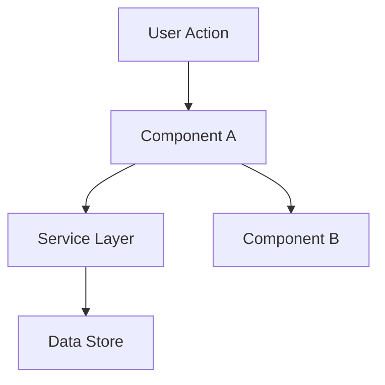

# design.md

# Design

**Goal**: Define HOW to build it. Architecture, components, what to reuse.

**Skip this phase when:** The change is straightforward — no architectural decisions, no new patterns, no component interactions to plan. For simple features, design happens inline during Execute.

## Process

### 1. Load Context

Read `.pulse/specs/features/[feature]/spec.md` before designing. If `.pulse/specs/features/[feature]/context.md` exists, load it too — it contains implementation decisions that constrain the design (layout choices, behavior preferences, interaction patterns). Decisions marked as "Agent's Discretion" are yours to decide.

Read STATE.md active AD-NNN entries and **confirmed** lessons. Conform or supersede (new AD-NNN). Silently ignoring an active decision is not allowed.

If `surface.md` exists, Design serves that frozen surface — do not invent a different public API.

If a [threat-model.md](threat-model.md) trigger is present, write `threat-model.md` in this phase and map each TM-ID to a spec SHALL or an explicit deferral.

### 1.5. Research (Optional but Recommended)

If the feature involves unfamiliar technology, patterns, or integrations, research before designing. Document findings briefly in the design doc or as inline notes. This prevents incorrect assumptions from propagating into tasks.

Follow the **Knowledge Verification Chain** (see SKILL.md) in strict order:

```
Codebase → Project docs → Context7 MCP → Web search → Flag as uncertain
```

**CRITICAL: NEVER assume or fabricate information.** If you cannot find an answer through the chain, explicitly say "I don't know" or "I couldn't find documentation for this". Inventing an API, a pattern, or a behavior that doesn't exist is far worse than admitting uncertainty. Wrong assumptions propagate through design → tasks → implementation and cause cascading failures.

Good triggers for research: new libraries, unfamiliar APIs, performance-sensitive features, security-sensitive features, patterns you haven't used in this codebase before.

### 2. Define Architecture

Overview of how components interact. Use mermaid diagrams when helpful. Before creating any diagrams, check if the `mermaid-studio` skill is available (see Skill Integrations in SKILL.md).

### 3. Identify Code Reuse

**CRITICAL**: What existing code can we leverage? This saves tokens and reduces errors.

If `.pulse/specs/codebase/CONCERNS.md` exists, check it before designing. Any component flagged as fragile, carrying tech debt, or having test coverage gaps requires extra care in the design — document how the design mitigates those concerns.

### 4. Define Components and Interfaces

Each component: Purpose, Location, Interfaces, Dependencies, What it reuses.

### 5. Define Data Models

If the feature involves data, define models before implementation.

---

## Template: `.pulse/specs/[feature]/design.md`

````markdown
# [Feature] Design

**Spec**: `.pulse/specs/[feature]/spec.md`
**Status**: Draft | Approved

---

## Architecture Overview

[Brief description of the architecture approach]


````

---

## Code Reuse Analysis

### Existing Components to Leverage

| Component            | Location            | How to Use                |
| -------------------- | ------------------- | ------------------------- |
| [Existing Component] | `src/path/to/file`  | [Extend/Import/Reference] |
| [Existing Utility]   | `src/utils/file`    | [How it helps]            |
| [Existing Pattern]   | `src/patterns/file` | [Apply same pattern]      |

### Integration Points

| System         | Integration Method                      |
| -------------- | --------------------------------------- |
| [Existing API] | [How new feature connects]              |
| [Database]     | [How data connects to existing schemas] |

---

## Components

### [Component Name]

- **Purpose**: [What this component does - one sentence]
- **Location**: `src/path/to/component/`
- **Interfaces**:
  - `methodName(param: Type): ReturnType` - [description]
  - `methodName(param: Type): ReturnType` - [description]
- **Dependencies**: [What it needs to function]
- **Reuses**: [Existing code this builds upon]

### [Component Name]

- **Purpose**: [What this component does]
- **Location**: `src/path/to/component/`
- **Interfaces**:
  - `methodName(param: Type): ReturnType`
- **Dependencies**: [Dependencies]
- **Reuses**: [Existing code]

---

## Data Models (if applicable)

### [Model Name]

```typescript
interface ModelName {
  id: string
  field1: string
  field2: number
  createdAt: Date
}
```

**Relationships**: [How this relates to other models]

### [Model Name]

```typescript
interface AnotherModel {
  id: string
  // ...
}
```

---

## Error Handling Strategy

| Error Scenario | Handling      | User Impact      |
| -------------- | ------------- | ---------------- |
| [Scenario 1]   | [How handled] | [What user sees] |
| [Scenario 2]   | [How handled] | [What user sees] |

---

## Tech Decisions (only non-obvious ones)

| Decision          | Choice          | Rationale     |
| ----------------- | --------------- | ------------- |
| [What we decided] | [What we chose] | [Why - brief] |

Record a STATE.md AD-NNN only when the choice is hard to reverse, surprising without context, and the product of a real trade-off. Feature-local obvious choices stay in this table.

## File References

Copy the spec index subset this design depends on (`path:line` + why). Tasks copy their slice from here.

## Threat Model

If no trigger: `N/A because [reason]`. If trigger: link `threat-model.md`.

---

## Tips

- **Load context first** — If context.md exists, decisions there are locked
- **Research when uncertain** — 5 minutes of research prevents hours of rework
- **Reuse is king** — Every component should reference existing patterns
- **Interfaces first** — Define contracts before implementation
- **Keep it visual** — Diagrams save 1000 words (check mermaid-studio skill in Skill Integrations)
- **Small components** — If component does 3+ things, split it
- **Check CONCERNS.md** — If it exists, flag fragile areas the design must address
- **Confirm before Tasks** — User approves design via [user-input.md](user-input.md) before breaking into tasks

# state-management.md

# State Management

**Purpose:** Persistent memory across sessions - decisions, blockers, learnings.

## Structure

**Output:** `.pulse/specs/project/STATE.md`

```markdown
# State

**Last Updated:** [ISO timestamp]
**Current Work:** [Feature name] - [Task identifier]

---

## Recent Decisions (Last 60 days)

### AD-[NNN]: [Decision title] ([date])

**Decision:** [What was decided]
**Reason:** [Why this choice]
**Trade-off:** [What was sacrificed]
**Impact:** [How this affects implementation]

### AD-[NNN]: [Decision title] ([date])

[Same structure]

---

## Active Blockers

### B-[NNN]: [Blocker description]

**Discovered:** [Date]
**Impact:** [Severity and scope]
**Workaround:** [Temporary solution if available]
**Resolution:** [Path to permanent fix]

---

## Lessons Learned

### L-[NNN]: [Learning description]

**Signal:** ac_gap | surviving_mutant | spec_precision_gap | spec_deviation | gate_fail | review_valid
**Source:** [file:line or AC id]
**Feature:** [slug]
**Status:** candidate | confirmed | quarantined
**Context:** [Situation that occurred]
**Problem:** [What went wrong]
**Solution:** [How it was resolved]
**Prevents:** [What this knowledge prevents in future]

---

## Quick Tasks

| #   | Description              | Date   | Spec                         | Status                |
| --- | ------------------------ | ------ | ---------------------------- | --------------------- |
| 001 | [Quick task description] | [date] | `.pulse/specs/quick/001-slug/`     | ⏳ Awaiting Approval  |
| 002 | [Quick task description] | [date] | `.pulse/specs/quick/002-slug/`     | ✅ Done               |

---

## Deferred Ideas

Ideas captured during work that belong in future features or phases. Prevents scope creep while preserving good ideas.

- [ ] [Idea description] — Captured during: [feature/phase]
- [ ] [Idea description] — Captured during: [feature/phase]

---

## Todos

Capture in-progress thoughts and action items that don't fit in active tasks.

- [ ] [TODO: action item]
- [ ] [TODO: action item]
```

## When to Update

| Event                            | Action                                 |
| -------------------------------- | -------------------------------------- |
| Significant architectural choice | Add AD-[NNN]                           |
| Implementation blocked           | Add B-[NNN]                            |
| Important discovery/learning     | Add L-[NNN] with **Signal** + **Source** ([lessons.md](lessons.md)) |
| Quick task started (plan ready)  | Create `.pulse/specs/quick/NNN-slug/TASK.md`, update Current Work, add Quick Tasks row ⏳ |
| Quick task completed             | Update TASK.md, create SUMMARY.md, set Quick Tasks row ✅ Done          |
| Scope creep captured             | Add to Deferred Ideas                  |
| In-progress thought              | Add to Todos                           |
| Session end                      | Update "Last Updated" + "Current Work" |

## Size Management (Hybrid Strategy)

**Zones:**

- 🟢 <7k tokens: No action
- 🟡 7-10k tokens: Footer note "STATE.md at [X]k. Cleanup recommended."
- 🔴 >10k tokens: Active prompt "STATE.md critical ([X]k). Cleanup now?"

**Cleanup process:**

- Move decisions >60 days to STATE-ARCHIVE.md
- Keep only active blockers
- Preserve recent learnings (<60 days)

**Validation:**

- Decisions have clear rationale?
- Blockers include resolution path?
- Learnings are actionable?

---

## Preferences

Track user-facing behavioral state in STATE.md:

```markdown
## Preferences

**Model Guidance Shown:** [ISO date or "never"]
```

**Update when:**

| Event                       | Action                   |
| --------------------------- | ------------------------ |
| First model tip given       | Set date                 |
| User acknowledges/dismisses | Keep date (don't repeat) |

This prevents repetitive suggestions while maintaining natural, helpful behavior.

# user-input.md

# User Input (CLI)

**Applies to:** Every phase of this skill. All reference docs defer here when user input is required.

## Rules (mandatory)

1. **No intermediate artifacts for questions** — Never create question files, screens, menus, UI components, JSON, Markdown drafts, or any other mechanism to collect answers. The terminal (chat) is the only interaction channel.
2. **Work first, ask last** — Continue executing until it is impossible to proceed without a user decision. Do as much autonomous work as allowed (codebase analysis, drafting, validation) before stopping.
3. **Batch pending questions** — When blocked, present **all** pending questions together at the **end** of the response.
4. **Stop after questions** — End the response immediately after the questions. Do not continue the workflow, create deliverables that depend on answers, or add closing commentary.
5. **Never invent mandatory answers** — Do not assume defaults or fabricate values when information is required. Infer only from explicit user input or verifiable project artifacts (code, `.pulse/specs/`, docs).
6. **Resume from interruption** — After the user replies (e.g. `A`, `B`, `1`, `Sim`, or free text), continue exactly from where execution stopped.

## Format

Use plain text suitable for a terminal. Always end with `Resposta:` on its own line.

**Delivery:** Wrap the **entire** question block in a ` ```text ` fenced code block so chat does not collapse line breaks. No markdown lists, bullets, or tables inside the block.

**English equivalent header:** `I need some information before continuing.`

### Pre-send checklist (mandatory)

Before sending, verify ALL of these. If any fails, rewrite — do not send.

| Check | Pass condition |
| ----- | -------------- |
| Numbered questions | Every question line starts with `N.` |
| Options separated | No single line contains `A)` and `B)` (or any two option letters) |
| One option per line | Count of lines matching `^[A-Z]\)` equals total options |
| Blank lines | Empty line after question text; empty line between question blocks |
| Footer | `Resposta:` alone on the last line inside the fence |
| Fence | Whole block inside ` ```text ` … ` ``` ` |

**Detection regex (mental check):** if you see ` B)` or ` C)` or ` D)` anywhere except at the start of a line (after newline), the output is **invalid**.

### Layout rules (strict — violations break readability)

Every CLI question block MUST follow this structure exactly:

1. **Header** — one line, then blank line
2. **Each question** — numbered (`1.`, `2.`, …), question text on its own line, blank line, then options
3. **Each option** — exactly one option per line, format `A) texto` (letter + `)` + space + text)
4. **Between questions** — blank line after the last option of the previous question
5. **Footer** — blank line, then `Resposta:` alone on the last line

**NEVER:**

- Put multiple options on the same line
- Omit question numbers
- Put option text on the same line as the question (without a blank line before options)
- Use markdown lists (`-`, `*`), bullets, tables, or headings inside the question block
- Wrap options in parentheses blocks on one line

**BAD (do not output like this — options collapsed on one line):**

```text
Preciso de algumas informações antes de continuar.

O que você está construindo?
A) Opção A B) Opção B C) Opção C D) Outro

Quem é o público-alvo?
A) Iniciantes B) Experts C) Outro

Resposta:
```

**GOOD (always output like this — inside ```text fence):**

```text
Preciso de algumas informações antes de continuar.

1. O que você está construindo?

A) Plataforma de paper trading
B) Sistema de gestão de portfólio
C) API de negociação
D) Plataforma completa
E) Outro (descreva)

2. Quem é o público-alvo?

A) Investidores iniciantes
B) Traders experientes
C) Ambos
D) Outro (descreva)

Resposta:
```

### Full multi-question example (project-init — use this structure)

```text
Preciso de algumas informações antes de continuar.

1. O que você está construindo?

A) Plataforma de simulação de trading (paper trading)
B) Sistema de gestão de portfólio pessoal com saldo virtual
C) Projeto full-stack de estudo/portfólio
D) Plataforma completa pronta para produção
E) Outro (descreva)

2. Quem é o público-alvo e qual problema resolve?

A) Investidores iniciantes aprendendo a operar
B) Desenvolvedores estudando arquitetura
C) Uso pessoal para simular investimentos
D) Público geral — trading sem risco
E) Outro (descreva)

3. Qual é o foco da v1 neste momento?

A) Consolidar o que existe — gaps, testes, estabilidade
B) Completar features pendentes
C) Preparar para deploy
D) Adicionar novas features (descreva)
E) Outro (descreva escopo e exclusões)

4. Há restrições críticas?

A) Sem prazo — evolução contínua local
B) Prazo curto (descreva)
C) Apenas ambiente local
D) Preparar para produção em breve
E) Outro (descreva)

Resposta:
```

Keep option text short (one line each). If an option needs a sub-prompt (e.g. "descreva"), put it in parentheses at the end of that option line — never merge options to save space.

## Question design

- Options must be **concrete** (`Card layout` not `Option A` as label text — use letters only as selectors).
- Prefer **3–6 options** plus an **Other (describe)** escape when the set is not exhaustive.
- Use **free-text questions** (no alternatives) when the answer is open-ended.
- Group related decisions into one numbered question when possible; do not split into multiple round-trips unless answers depend on each other.
- For yes/no decisions, use `A) Sim` / `B) Não` or `1) Yes` / `2) No`.
- For multi-select, state it explicitly: `(escolha uma ou mais: A, C)`.

## What is NOT a question artifact

These are **deliverables**, not question mechanisms — still create them after answers are received:

- `.pulse/specs/project/PROJECT.md`, `ROADMAP.md`, `STATE.md`
- `.pulse/specs/features/[feature]/spec.md`, `context.md`, `design.md`, `tasks.md`
- `.pulse/specs/quick/NNN-slug/TASK.md`, `SUMMARY.md`
- `.pulse/specs/codebase/*` brownfield docs
- Validation reports, fix plans, task summaries

`context.md` stores **decisions already made** — never use it (or any file) as a questionnaire or pending-questions log.

## Approval and confirmation

When a phase requires user approval (design, tasks, quick-task pre-check, fix plans), create spec deliverables first when applicable (e.g. `.pulse/specs/quick/NNN-slug/TASK.md`), present the summary, then blocking questions in CLI format:

```
Preciso de algumas informações antes de continuar.

1. Aprovar [artefato] e prosseguir?

A) Sim, aprovar e continuar
B) Não, preciso de ajustes (descreva abaixo)

Resposta:
```

If the user chooses adjustments, wait for their description before revising.

## Pipeline migration (Quick mode → full spec)

When a request triggered as Quick mode but fails **Scope Eligibility** in [quick-mode.md](quick-mode.md), present:

```text
Preciso de algumas informações antes de continuar.

1. Este pedido excede o escopo do Quick mode: [motivo concreto — ex.: 5 arquivos, decisão de arquitetura, escopo vago]. Como deseja prosseguir?

A) Migrar para o pipeline completo (Specify → Design → Tasks → Execute, conforme escopo)
B) Quick fix: [recorte pré-definido 1 — uma linha, ≤3 arquivos]
C) Quick fix: [recorte pré-definido 2 — uma linha, ≤3 arquivos]
D) Cancelar

Resposta:
```

- **A)** Start [specify.md](specify.md) for the feature — do not keep a quick TASK.md
- **B/C…)** Re-assess eligibility with that predefined narrowed scope; if it passes, continue Quick mode
- **Last option (Cancelar)** Stop; no spec files unless the user reopens the request

**Closed choices only:** Do not use "descreva" or free-text options in this block. Do not include "Outro" — Pulse suppresses it for migration gates. List concrete quick-fix alternatives derived from your codebase analysis.

**Never** auto-start Specify, Design, or Tasks without the user selecting **A**.

## UAT and verification

Interactive UAT follows the same strict layout — one option per line, numbered question, blank lines between sections:

```
Preciso de algumas informações antes de continuar.

1. Teste: [Nome do teste]

Esperado: [comportamento observável]

A) Funciona como esperado
B) Não funciona (descreva o que vê)
C) Pular / não aplicável

Resposta:
```

Infer severity from free-text descriptions per [validate.md](validate.md). Never ask the user to rate severity.
