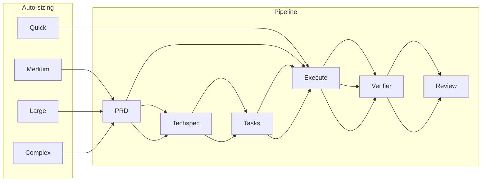
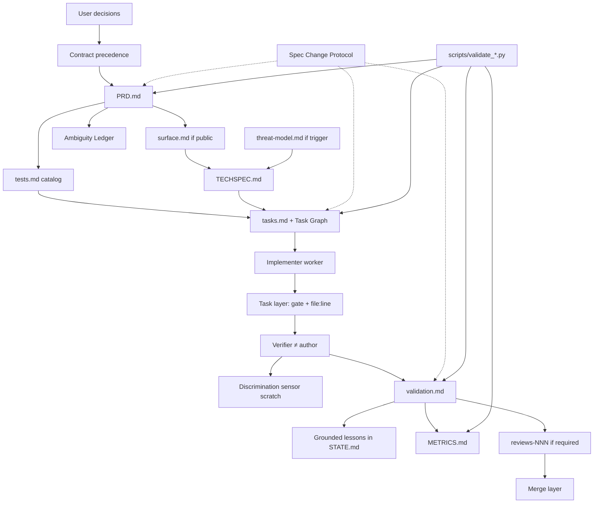

# Pulse architecture

How `pulse-spec-driven` 2.1.0 is assembled. Portable skill: markdown artifacts + Python gates. No daemon.

## Layers

| Layer | Proof | Role |
| ----- | ----- | ---- |
| Task | Gate exit 0 + assigned test IDs + `file:line` | Implementer |
| Feature | `validation.md` PASS + sensor or labeled fallback | Verifier |
| Merge | No open critical/high review issues | Reviewer, then user |

## What is not in the skill

- Git commits (user policy)
- Compozy daemon / spawn permissions
- Mandatory Idea Factory / council
- Atomic commit-as-law
